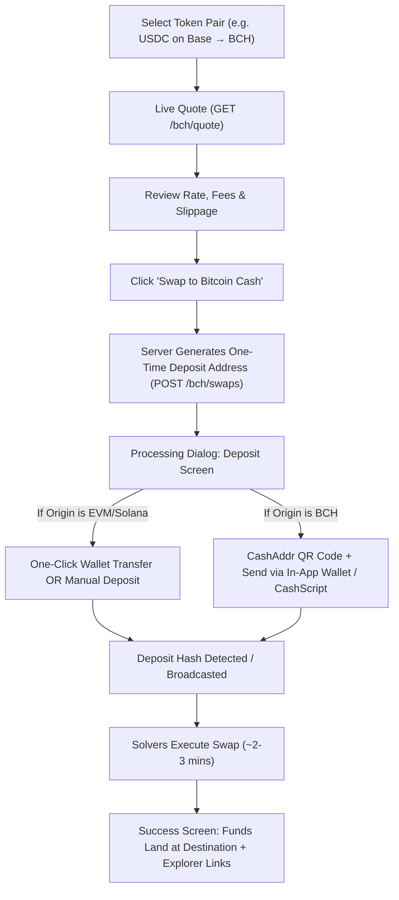

# Frontend Engineering Plan: BCH Cross-Chain Swaps & Admin Console

## Executive Summary
This document specifies the exact frontend architecture and implementation plan for integrating **Bitcoin Cash (BCH) bidirectional cross-chain swaps** into the web interface, matching the unified UX flows already established for Circle CCTP and Solana swaps (`src/swap-server/`), and adding a dedicated **BCH Operations & Monetization section** to the Admin Console (`src/admin/swap/`).

---

## 1. User Experience & Swap Flows

### 1.1 The User Flow: Bidirectional BCH Swaps
The frontend swap card (`BCHSwapCard.tsx` / `SwapServerRoot.tsx`) will seamlessly recognize any cross-chain pair involving Bitcoin Cash (e.g., **Base USDC ↔ BCH**, **Solana USDC ↔ BCH**, **Ethereum ↔ BCH**, **Arbitrum ↔ BCH**).



### 1.2 Modal / Processing Dialog UX (`ProcessingDialog.tsx`)
When a BCH swap is initiated:
1. **Deposit View**:
   - Shows dedicated, single-use **Deposit Address** with clear network warning.
   - High-contrast **QR Code** for mobile/hardware wallets.
   - **Copy Button** + 1-click clipboard notification.
   - Exact amount to send (in base units and formatted).
   - Dynamic **Countdown Timer** (e.g. "Valid for 59:45").
   - **One-Click Send Button**: If the user has an in-app or connected browser wallet for the origin chain (MetaMask, Phantom, or WDK BCH wallet), the UI offers an instant "Send from Wallet" button to automatically sign and dispatch the transfer.
2. **Active Processing View**:
   - Live status stepper with chameleon animation:
     - `1. Awaiting Deposit` (Waiting for blockchain mempool detection)
     - `2. Deposit Registered` (Tx hash logged on origin chain)
     - `3. Solver Executing` (Decentralized solvers filling cross-chain intent)
     - `4. Settled` (Tokens received by recipient)
3. **Completed View**:
   - Total amount delivered.
   - Dual explorer links:
     - Origin chain deposit explorer (e.g. Blockchair / Basescan / Solscan).
     - Destination chain settlement explorer.
   - Auto-saved into local transaction history (`SwapServerHistory.tsx`).

---

## 2. Swap Subsystem Architecture (`src/swap-server/`)

### 2.1 Route Resolution (`src/swap-server/routing.ts`)
Extend `resolveRoute` to detect BCH cross-chain pairs:
```typescript
export type SwapRoute =
    | { kind: 'usdc-cctp'; src: CctpChain; dst: CctpChain }
    | { kind: 'sol-jupiter'; inputMint: string; outputMint: string }
    | { kind: 'bch-crosschain'; fromToken: BchToken; toToken: BchToken }
    | { kind: 'unsupported'; reason: string };
```
- When `sell.chain === 'bch'` and `buy.chain !== 'bch'`, or `sell.chain !== 'bch'` and `buy.chain === 'bch'`, `resolveRoute` outputs `{ kind: 'bch-crosschain', ... }`.
- Validates minimum/maximum swap boundaries configured by `/config`.

### 2.2 Client API Client (`src/swap-server/api.ts`)
Add typed methods interfacing with `cctp-swap-server`:
```typescript
export interface BchQuoteResponse {
    fromToken: BchToken;
    toToken: BchToken;
    amountIn: string;
    amountInFormatted: string;
    amountOut: string;
    amountOutFormatted: string;
    minAmountOut: string;
    minAmountOutFormatted: string;
    timeEstimateSec: number;
    priceImpact?: number;
    ourFeeBps: number;
}

export interface BchSwapRecord {
    id: string;
    status: 'PENDING_DEPOSIT' | 'KNOWN_DEPOSIT_TX' | 'PROCESSING' | 'SUCCESS' | 'REFUNDED' | 'FAILED' | 'EXPIRED';
    depositAddress: string;
    depositMemo?: string;
    amountIn: string;
    amountInFormatted: string;
    expectedOut: string;
    expectedOutFormatted: string;
    recipient: string;
    refundTo: string;
    depositTxHash?: string;
    settleTxHash?: string;
    depositExplorerUrl?: string;
    settleExplorerUrl?: string;
    deadline: string;
    createdAt: number;
}
```
Methods:
- `getBchTokens(chain?: string): Promise<BchToken[]>`
- `getBchQuote(params: QuoteParams): Promise<BchQuoteResponse>`
- `createBchSwap(params: CreateSwapParams): Promise<BchSwapRecord>`
- `getBchSwap(id: string): Promise<BchSwapRecord>`
- `submitBchDepositTx(id: string, txHash: string): Promise<BchSwapRecord>`
- `getBchSwaps(address?: string): Promise<BchSwapRecord[]>`

### 2.3 Swap Hook & State Machine (`src/swap-server/useSwapServerCard.ts`)
- Live quotes with automatic debouncing (300ms).
- Dynamic recipient derivation:
  - If target is BCH: uses connected CashAddr wallet.
  - If target is EVM: uses connected EVM account.
  - If target is Solana: uses connected Phantom/Solana pubkey.
  - Allows custom recipient address override.
- Dynamic refund address derivation:
  - Default origin wallet for emergency solver refunds if conditions are not met.

---

## 3. Admin Console BCH Section (`src/admin/swap/`)

### 3.1 New Navigation & Sub-Pages
Under the `/admin/swap/*` operator section, add the dedicated BCH suite:

```
/admin/swap/
├── overview       (Unified multi-chain dashboard)
├── cctp           (Circle CCTP USDC transfers)
├── solana         (Jupiter Solana swaps)
├── bch ⭐         (NEW: Bitcoin Cash Cross-Chain Operations)
│   ├── swaps      (Live table of all incoming & outgoing BCH swaps)
│   ├── :id        (Individual swap inspector & solver audit)
│   └── tokens     (1Click Multi-Chain Token Directory & liquidity)
├── settings       (Updated: Live BCH fee & pause controls)
└── profits        (Updated: BCH margin & revenue analytics)
```

### 3.2 Pages & Components To Implement

#### A. `BchSwapsPage.tsx` (`/admin/swap/bch`)
- **Key Metrics Header**:
  - Total Volume ($ USD)
  - 24h Swaps Count
  - Average Settlement Time (~180s)
  - Cumulative App Fee Earned ($ USD settled to NEAR)
- **Interactive Swaps Table**:
  - Columns: Timestamp, Swap ID, Flow (`Base USDC → BCH` or `BCH → Arbitrum USDC`), Amount In, Amount Out, Status Badge, Deposit Tx, Settlement Tx, Actions.
  - Filter chips: `All`, `Pending Deposit`, `Processing`, `Success`, `Refunded`, `Failed`.
  - Search bar: Filter by swap ID, deposit address, recipient, or tx hash.

#### B. `BchSwapDetailPage.tsx` (`/admin/swap/bch/:id`)
- Full audit inspector:
  - Timeline of execution timestamps (Created → Deposit Seen → Solver Matched → Settled).
  - Verifiable links to Blockchair (BCH) and origin/destination blockchain explorers.
  - Fee audit: Gross amount, solver spread, and app fee collected (`ourFeeBps`).
  - Error logs (if solver failed or deadline expired).

#### C. `BchSettingsCard.tsx` (In `/admin/swap/settings`)
- **Emergency Circuit Breaker**:
  - Instant Pause button with required reason field.
  - Resume button.
- **Dynamic Fee Controls**:
  - Live slider & input for `feeBps` (0 bps to 200 bps).
  - Updates without server restarts.
- **NEAR Fee Recipient**:
  - Input field for NEAR account ID (e.g. `bchintents.near`).
- **Safety Limits**:
  - Minimum swap USD input (default: $10).
  - Maximum swap USD input (default: $25,000).

#### D. Revenue & Profit Dashboard Updates (`ProfitPages.tsx`)
- Include BCH revenue metrics:
  - Total fees earned in USD.
  - Breakdown by direction: Towards BCH vs From BCH.
  - NEAR treasury balance tracking for fee payouts.

---

## 4. Implementation Steps

| Step | Scope | Target Files |
|---|---|---|
| **Step 1** | Route & API Client | `src/swap-server/routing.ts`, `src/swap-server/api.ts`, `src/swap-server/types.ts` |
| **Step 2** | UI Flow & Steps | `src/swap-server/steps.ts`, `src/swap-server/flows.ts`, `src/swap-server/useSwapServerCard.ts` |
| **Step 3** | Processing Dialog | `src/swap-server/ProcessingDialog.tsx` (QR Code, CashAddr deposit screen) |
| **Step 4** | Admin API Client | `src/admin/swap/swapApi.ts`, `src/admin/swap/SwapAdminContext.tsx` |
| **Step 5** | Admin Pages | `src/admin/swap/BchPages.tsx` (Swaps table, detail view, token catalog) |
| **Step 6** | Admin Settings & Profit | `src/admin/swap/SwapOverviewPages.tsx`, `src/admin/swap/ProfitPages.tsx` |
| **Step 7** | Routes & Shell Nav | `src/admin/AdminRoutes.tsx`, `src/admin/AdminShell.tsx` |
| **Step 8** | Testing & Validation | Unit & integration tests in `src/swap-server/__tests__/` and `src/admin/swap/__tests__/` |

---

## 5. Security & Fail-Safe Features
1. **Address Validation**: Strict CashAddr regex validation on frontend before allowing swap creation to prevent lost user funds.
2. **Deposit Address Expiry**: Visual countdown warning user not to deposit after quote expiry.
3. **Refund Safety**: Dedicated `refundTo` field auto-populated with the user's origin chain address so 1Click contracts can safely return funds if liquidity is exhausted.
4. **Idempotent Broadcasts**: Origin deposit transaction hashes recorded immediately to prevent double submissions.
