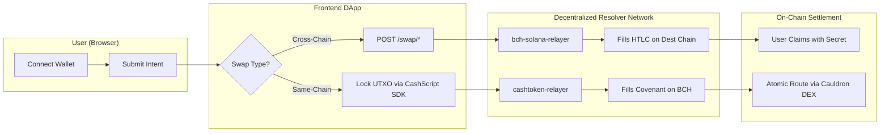

# Intents-Swaps: Frontend DApp

[](../docs/reviewers-guide/01-protocol-overview.md)
[](#license)

The **Intent Protocol Frontend** is a production-grade React/Vite single-page application that serves as the unified interface for submitting, tracking, and claiming **Cross-Chain** and **Same-Chain** intent-based swaps across **Bitcoin Cash**, **Solana**, and **Movement**.

Users express their swap intent (e.g., "I want to sell 0.1 BCH for SOL") through a gasless signing experience. The frontend broadcasts this intent to the **Decentralized Resolver Network**, which races to fill the order using Just-In-Time (JIT) liquidity.

### Related Repositories
This DApp interacts with two independent Resolver (Solver) backends:
* **[bch-solana-relayer](https://github.com/Intents-Swaps/bch-solana-relayer)**: Cross-Chain Resolver — fills BCH ↔ SOL and BCH ↔ MOVE atomic swaps via HTLCs.
* **[cashtoken-relayer](https://github.com/Intents-Swaps/cashtoken-relayer)**: Same-Chain Resolver — fills BCH ↔ CashToken (MUSD, PUSD, etc.) swaps via UTXO Covenants.

And the on-chain smart contracts they settle against:
* **[contracts-bch-crosschain](https://github.com/Intents-Swaps/contracts-bch-crosschain)** — CashScript HTLCs on Bitcoin Cash.
* **[contracts-solana](https://github.com/Intents-Swaps/contracts-solana)** — Anchor Escrow Programs on Solana.
* **[contract-movement](https://github.com/Intents-Swaps/contract-movement)** — Move Escrow Modules on Movement.
* **[contracts-bch-swap](https://github.com/Intents-Swaps/contracts-bch-swap)** — CashScript Covenants for Same-Chain Limit Orders & Dutch Auctions.

---

## Architecture



### Core User Flow

1. **Connect Wallets** — The user connects their BCH wallet (via WIF/Cashaddr), Solana wallet (Phantom/Solflare), and/or Movement wallet (Petra/Nightly) simultaneously.
2. **Express Intent** — The user selects a token pair (e.g., BCH → SOL), enters amounts, and chooses Market or Limit order type.
3. **Gasless Signing** — For cross-chain swaps, the frontend generates a cryptographic `hashlock` and broadcasts the intent to the appropriate Resolver API. The user never pays gas on the destination chain.
4. **Resolver Fills** — An independent Resolver picks up the intent and locks counter-liquidity on the destination chain.
5. **User Claims** — The frontend detects the fill, reveals the `secret` preimage, and the user claims their funds atomically.

### Dual Resolver Integration

| Feature | `bch-solana-relayer` | `cashtoken-relayer` |
|---|---|---|
| **Swap Type** | Cross-Chain (BCH ↔ SOL, BCH ↔ MOVE) | Same-Chain (BCH ↔ CashTokens) |
| **Settlement** | HTLCs with Delta Timelocks | UTXO Covenants with Introspection |
| **User Action** | Lock on source → Claim on dest | Lock BCH → Resolver fills atomically |
| **API Pattern** | REST (`/swap/bch-to-sol`, `/swap/move-to-bch`) | UTXO Polling (mempool monitoring) |
| **Secret Reveal** | User claims with preimage on dest chain | Resolver detects and claims source |

---

## Key Pages

| Route | Component | Description |
|---|---|---|
| `/` | `LandingPage` | Premium bento-grid landing with protocol stats and getting-started cards |
| `/trade` | `BchSwapPage` | Main swap interface — Market/Limit orders, token selection, order history |
| `/explore` | `ExplorePage` | Global transaction explorer aggregating all chains |
| `/portfolio` | `PortfolioPage` | User's cross-chain portfolio and activity feed |
| `/solver` | `SolverPage` | Resolver dashboard — wallet balances, fill/claim financials, active intents |
| `/monitor` | `MonitorPage` | Live network health monitor for Resolver node operators |

---

## Tech Stack

| Layer | Technology |
|---|---|
| Framework | React 18 + Vite 5 |
| Styling | Tailwind CSS + shadcn/ui |
| BCH Wallet | `mainnet-js` / `cashscript` (WIF-based) |
| Solana Wallet | `@solana/wallet-adapter` (Phantom, Solflare) |
| Movement Wallet | `@aptos-labs/ts-sdk` + Petra/Nightly |
| State Management | React Context + localStorage persistence |
| Price Feeds | Pyth Network Oracle (`@pythnetwork/price-service-client`) |
| Notifications | Sonner toast library |
| Routing | React Router v6 |

---

## Setup & Development

### Prerequisites
- **Node.js** v18+
- **npm** or **pnpm**

### Installation

```bash
# Clone the repository
git clone https://github.com/Intents-Swaps/frontend.git
cd frontend

# Install dependencies
npm install

# Configure environment
cp .env.example .env
# Edit .env with your RPC endpoints and relayer URLs
```

### Environment Variables

```env
VITE_CROSS_CHAIN_RELAYER_URL=https://your-cross-chain-relayer.up.railway.app
VITE_MESH_SERVER_URL=https://your-chipnet-mesh-server.example
VITE_MESH_SERVER_MAINNET_URL=https://your-mainnet-mesh-server.example
VITE_CCTP_SWAP_SERVER_URL=https://your-testnet-cctp-swap-server.example
VITE_CCTP_SWAP_SERVER_MAINNET_URL=https://your-mainnet-cctp-swap-server.example
VITE_SOLANA_RPC_URL=https://api.devnet.solana.com
VITE_MOVEMENT_NODE_URL=https://aptos.testnet.porto.movementlabs.xyz/v1
```

### Run Locally

```bash
# Development server (hot-reload)
npm run dev

# Production build
npm run build

# Preview production build
npm run preview
```

---

## Security & Review Focus

Reviewers examining this frontend should focus on:

* **Secret Management** — The `hashlock` and `secret` are generated client-side using `crypto.getRandomValues()`. Verify the preimage is never leaked before the user is ready to claim.
* **Wallet Address Resolution** — Ensure `recipientAddress` is correctly resolved from the connected wallet for each swap direction (BCH, SOL, MOVE).
* **Relayer URL Configuration** — Validate that no hardcoded `localhost` URLs remain in production builds. All Resolver endpoints must be sourced from environment variables.
* **Order Persistence** — Orders are persisted to `localStorage` under the `bch_swap_orders` key. Verify that sensitive data (secrets) is handled appropriately.

---

## Future-Proofing: The 2026 STARK Upgrade

As the protocol transitions from HTLCs to **Triton VM STARK proofs**, the frontend will evolve to:

1. **Eliminate the Claim Step** — Users will receive funds directly without needing to reveal a secret, as STARK proofs will handle verification asynchronously.
2. **Support Bounded Loop Pricing** — Advanced non-linear pricing curves will be visualized in the Limit Order UI. Note: the underlying opcodes (`OP_BEGIN`/`OP_UNTIL`, part of the "Layla" upgrade) already activated 2026-05-15 — this item is now blocked only on the contracts/frontend work to use them, not on a future network upgrade. See `cashtoken-relayer/docs/future/03-partial-order-fills.md` and `04-twap-orders.md` for designs that depend on this.
3. **Multi-Resolver Discovery** — The frontend will query a decentralized registry of Resolver nodes instead of a single configured endpoint.

---

## 📜 License

**Copyright (c) 2026 Intents-Swaps. All Rights Reserved.**
This software and associated documentation files are proprietary and confidential. No part of this repository may be copied, reproduced, distributed, or modified without explicit written permission.

*Part of the Intents Swap Protocol Ecosystem — Bringing Intent-based DeFi to Bitcoin Cash.*
