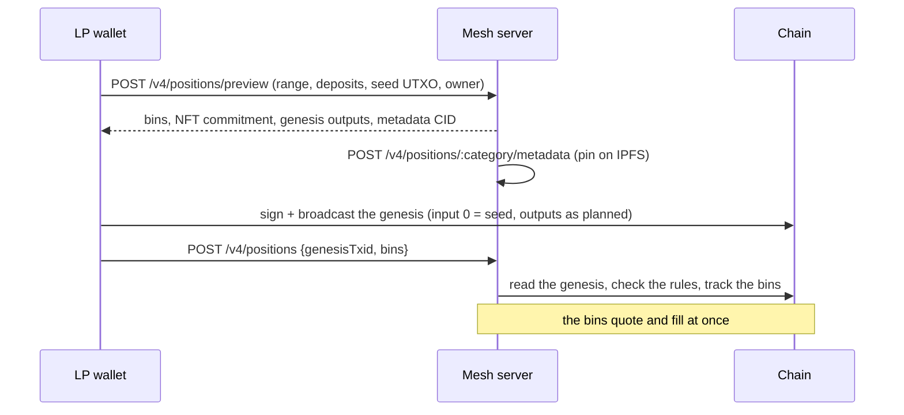

A **V4 position** is a set of `MeshBinV4` bins owned by **one NFT**. Whoever holds the NFT controls every bin: withdrawing, repricing and moving liquidity all need it, and sending the NFT sends the position. Each bin is one UTXO at one grid level. It holds BCH and the pair's token and trades **in place**: every fill recreates the same UTXO at the same address with new balances.

Trading needs nothing new. `POST /api/v1/quote`, `/router/quote` and the solver route through V4 bins together with V3 pools and Cauldron, and a quote's `hops[].contract` shows `MeshBinV4`.

All V4 routes are under `/api/v1/v4`. Amounts are strings of base units (sats or token units). Categories are 64-hex in display order. Write routes are rate-limited per client (`V4_RATE_LIMIT_PER_MIN`, default 30).

## The flow



1. **Pick a seed.** This is a UTXO in the LP's wallet that is **output #0** of its transaction. Its txid becomes the position's category, i.e. the NFT's token ID. If the wallet has none, send yourself a small amount first: that transaction's output 0 is a seed.
2. **Preview** the position.
3. **Build the genesis.** Input 0 is the seed. Add funding inputs (BCH, plus the token if there are ask bins). Then add the preview's `outputs` **in order**, followed by your change. Sign and broadcast.
4. **Register** the genesis.

---

```endpoint
{
  "method": "POST",
  "path": "/api/v1/v4/positions/preview",
  "summary": "Plan a position: bins on the price grid, the NFT, the exact genesis outputs and the metadata. Nothing is stored except the plan's registry (for pinning).",
  "params": [
    { "name": "tokenCat", "in": "body", "type": "string", "required": true, "description": "The token the position trades against BCH (64-hex category)." },
    { "name": "binStepBps", "in": "body", "type": "number", "description": "Grid step in basis points, 1–1000. Default 100 (1%). Level i of step s is (1 + s/10000)^i sats per token unit." },
    { "name": "lowIndex / highIndex", "in": "body", "type": "number", "description": "The range as grid levels (at most 128 bins). Or give lowPrice / highPrice in sats per token unit (snapped to the nearest level)." },
    { "name": "marketIndex", "in": "body", "type": "number", "required": true, "description": "Bins at or below this level start as BCH bids; above it, token asks. Or marketPrice." },
    { "name": "depositSats", "in": "body", "type": "string", "description": "BCH for the bid bins (each gets at least 2,000 sats or is left out)." },
    { "name": "depositTokens", "in": "body", "type": "string", "description": "Tokens for the ask bins. Each ask bin also carries 1,000 sats." },
    { "name": "shape", "in": "body", "type": "string", "description": "spot (even), curve (most near the market) or bidask (most at the edges). Default spot." },
    { "name": "strength", "in": "body", "type": "string", "description": "gentle, standard (default) or aggressive." },
    { "name": "seedTxid", "in": "body", "type": "string", "required": true, "description": "Txid whose output #0 the wallet spends at input 0. It becomes the position's category." },
    { "name": "owner", "in": "body", "type": "string", "required": true, "description": "Cashaddr the NFT goes to (token-aware or not)." },
    { "name": "name", "in": "body", "type": "string", "description": "Shown by wallets (BCMR). Default: 'Mesh range <low>–<high> sats/unit'." }
  ],
  "body": {
    "tokenCat": "dfe50223c8d5cba8dcef8dff6d92b61deb88a8ba44947367f2b746487b56039b",
    "binStepBps": 100, "lowIndex": 761, "highIndex": 764, "marketIndex": 762,
    "depositSats": "40000", "depositTokens": "20", "shape": "spot",
    "seedTxid": "601c4562a64779b44e854a0d77953a54c1735007283035ac79e826cdff711e69",
    "owner": "bchtest:zpmnrn7s7c426vr849r3rs4euxsk3n2ghgkrfhvfx7", "name": "Range BCH/pUSD"
  },
  "responses": [
    {
      "status": 200,
      "body": {
        "category": "601c4562…e69",
        "commitment": { "version": 1, "shape": "spot", "variant": "default", "tokenCat": "dfe50223…39b", "binStepBps": 100, "lowIndex": 761, "highIndex": 764, "binCount": 4, "managerHash": "0000…0000", "createdHeight": 328200 },
        "commitmentHex": "0100dfe5…020500",
        "bins": [
          { "index": 0, "level": 761, "side": "bid", "address": "bchtest:pva52tnm…", "lockingBytecode": "aa203b45…87", "sats": "20000", "tokens": "0",
            "bidSatsPerUnit": 1943.41, "askSatsPerUnit": 1962.85,
            "params": { "tokenCat": "dfe50223…39b", "ownerCat": "601c4562…e69", "bidNum": "4376180508496244883", "bidDen": "2251799813685248", "askNum": "4419942313581207332", "askDen": "2251799813685248" } },
          { "index": 2, "level": 763, "side": "ask", "sats": "1000", "tokens": "10", "bidSatsPerUnit": 1982.48, "askSatsPerUnit": 2002.30 }
        ],
        "outputs": [
          { "role": "identity", "lockingBytecode": "76a9142656…88ac", "valueSatoshis": "800" },
          { "role": "nft", "lockingBytecode": "76a9147731…88ac", "valueSatoshis": "1000", "token": { "category": "601c4562…e69", "amount": "0", "nft": { "capability": "mutable", "commitment": "0100dfe5…020500" } } },
          { "role": "bin", "binIndex": 0, "lockingBytecode": "aa203b45…87", "valueSatoshis": "20000" },
          { "role": "bin", "binIndex": 2, "lockingBytecode": "aa209332…87", "valueSatoshis": "1000", "token": { "category": "dfe50223…39b", "amount": "10" } },
          { "role": "metadata", "lockingBytecode": "6a0442434d5220af77…", "valueSatoshis": "0" }
        ],
        "metadata": { "sha256": "af77d2c1…6ddb", "cid": "bafkreifpo7jmd4xldljsgolrskc34amq33yc65cnuteerimbhkzzjdtn3m", "uri": "ipfs://bafkreifp…n3m", "registry": "{ BCMR v2 registry }", "pinProvider": "none", "pinPath": "/api/v1/v4/positions/601c4562…e69/metadata", "httpsCopy": "/api/v1/v4/metadata/601c4562…e69.json" },
        "totals": { "sats": "42000", "tokens": "20", "bidBins": 2, "askBins": 2, "outputSats": "43800" },
        "estimatedBytes": 1059,
        "warnings": [],
        "genesis": { "input0": { "txid": "601c4562…e69", "vout": 0 } },
        "register": { "method": "POST", "path": "/api/v1/v4/positions", "body": { "genesisTxid": "<txid after broadcast>", "bins": ["…params of every bin…"] } }
      }
    },
    { "status": 400, "body": { "error": "highIndex must be ≥ lowIndex" } },
    { "status": 409, "description": "The seed's txid is already a registered position's category: pick another seed.", "body": { "error": "a position with category 601c…e69 is already registered: pick another seed UTXO" } },
    { "status": 503, "description": "The server has no Mesh identity address (V4_IDENTITY_ADDRESS).", "body": { "error": "V4 identity output not configured (V4_IDENTITY_ADDRESS)" } }
  ]
}
```

**Genesis outputs, in this order** (the server checks them when you register):

| # | Role | What it is |
|---|---|---|
| 0 | `identity` | 800 sats to Mesh's metadata key. Whoever spends output 0 can publish new metadata for the position, so Mesh keeps it, and transfers of the position never touch it |
| 1 | `nft` | The position NFT: a **mutable** NFT of the new category with the v1 commitment, to `owner` |
| 2… | `bin` | One output per bin: its P2SH32 locking bytecode, its sats and, for ask bins, its tokens |
| last | `metadata` | `OP_RETURN 'BCMR' <sha256> 'ipfs://<cid>'`: where wallets find the position's name and fields |

Add change outputs **after** these. A bin buys at its own level and sells one level up, so each round trip through it earns one grid step.

```endpoint
{
  "method": "POST",
  "path": "/api/v1/v4/positions/:category/metadata",
  "summary": "Pin the planned BCMR registry on IPFS. Only registries the server planned (or registered) can be pinned. The provider must return the same CID the genesis publishes, or nothing is published.",
  "params": [{ "name": "category", "in": "path", "type": "string", "required": true, "description": "The position category (the seed txid)." }],
  "responses": [
    { "status": 200, "body": { "pinned": true, "cid": "bafkreifpo7jmd4xldljsgolrskc34amq33yc65cnuteerimbhkzzjdtn3m", "uri": "ipfs://bafkreifp…n3m", "provider": "pinata" } },
    { "status": 404, "body": { "error": "no planned or registered registry for this category" } },
    { "status": 502, "description": "The provider failed or stored the file under another CID.", "body": { "error": "the provider stored the registry as bafy…, expected bafkrei…: not published" } },
    { "status": 503, "description": "No pinning provider configured. The CID in the genesis is still valid: pin the same bytes later.", "body": { "error": "no pinning provider configured (METADATA_PIN_PROVIDER)", "cid": "bafkreifp…n3m", "uri": "ipfs://bafkreifp…n3m" } }
  ]
}
```

The CID is computed from the registry's exact bytes (CIDv1, raw, sha2-256), so the genesis can carry it before anything is uploaded. Pinning can happen before or after broadcast, or be repeated with another provider. Servers set `METADATA_PIN_PROVIDER=pinata` with `PINATA_JWT`, or `kubo` with `IPFS_API_URL` (and `IPFS_API_TOKEN`) for any Kubo-compatible endpoint, such as Filebase or your own node.

```endpoint
{
  "method": "GET",
  "path": "/api/v1/v4/metadata/:category.json",
  "summary": "The registry file itself, exactly as published (its sha256 is the one on chain). CORS open.",
  "responses": [
    { "status": 200, "description": "application/json: the BCMR v2 registry." },
    { "status": 404, "body": { "error": "no registry for this category" } }
  ]
}
```

```endpoint
{
  "method": "POST",
  "path": "/api/v1/v4/positions",
  "summary": "Register a broadcast genesis. The server reads it from the chain and checks: input 0 spends an output #0 (the category is its txid); exactly one NFT of the category, not minting, with no fungible amount; a valid v1 commitment; every listed bin names the category and is funded in this transaction. The bins then quote and fill at once.",
  "params": [
    { "name": "genesisTxid", "in": "body", "type": "string", "required": true, "description": "Txid of the broadcast genesis." },
    { "name": "bins", "in": "body", "type": "array", "required": true, "description": "The bins' params, as in the preview's register.body.bins (1–512)." },
    { "name": "pairName", "in": "body", "type": "string", "description": "Label, e.g. BCH/pUSD." }
  ],
  "body": { "genesisTxid": "3dd4be219caacd7f252588cb5240d420cfc056196f1d9021d7c4c0d898a2ec0c", "bins": ["…"], "pairName": "BCH/pUSD" },
  "responses": [
    { "status": 201, "description": "The position, as GET /positions/:category returns it.", "body": { "category": "601c4562…e69", "genesisTxid": "3dd4be21…ec0c", "nftOutput": 1, "pairName": "BCH/pUSD", "metadata": { "sha256": "af77d2c1…6ddb", "uri": "ipfs://bafkreifp…n3m" }, "totals": { "sats": "42000", "tokens": "20", "valueAtBidSats": "81847", "bins": 4, "binsWithTokens": 2 } } },
    { "status": 400, "body": { "error": "genesisTxid must be a 64-char lowercase hex txid" } },
    { "status": 404, "description": "The genesis is not on the chain (yet): retry after broadcast.", "body": { "error": "genesis 3dd4…ec0c not found: …" } },
    { "status": 409, "body": { "error": "position 601c…e69 is already registered" } },
    { "status": 422, "description": "A genesis rule failed. The code says which: G1 input 0, G2 not new, G3 NFT shape, G4 commitment, G5 bins.", "body": { "error": "G5: bin 1: ownerCat is not the genesis category" } }
  ]
}
```

```endpoint
{
  "method": "GET",
  "path": "/api/v1/v4/positions",
  "summary": "Positions. With holder: the positions whose NFT that address holds now, read from the chain. Ownership follows the NFT, so this changes when the NFT is sent.",
  "params": [
    { "name": "holder", "in": "query", "type": "string", "description": "A cashaddr. Returns its positions with the NFT outpoint." },
    { "name": "token", "in": "query", "type": "string", "description": "Only positions of this token (without holder)." },
    { "name": "limit", "in": "query", "type": "number", "description": "1–200, default 50 (without holder)." }
  ],
  "responses": [
    { "status": 200, "body": { "holder": "bchtest:zpmnrn7s…", "positions": [{ "category": "601c4562…e69", "totals": { "sats": "42000", "tokens": "20" }, "nft": { "txid": "3dd4be21…ec0c", "vout": 1, "capability": "mutable", "commitment": "0100dfe5…" } }] } }
  ]
}
```

```endpoint
{
  "method": "GET",
  "path": "/api/v1/v4/positions/:category",
  "summary": "One position: commitment, metadata, totals and every bin with its live UTXO, prices and what it can trade now. valueAtBidSats is what the bins would pay to unwind at their own bids.",
  "params": [
    { "name": "category", "in": "path", "type": "string", "required": true, "description": "Position category." },
    { "name": "holder", "in": "query", "type": "string", "description": "If this address holds the NFT, holder is filled in." }
  ],
  "responses": [
    { "status": 200, "body": { "category": "601c4562…e69", "bins": [{ "index": 0, "address": "bchtest:pva52tnm…", "variant": "default", "bid": { "num": "4376180508496244883", "den": "2251799813685248", "satsPerUnit": 1943.41 }, "ask": { "satsPerUnit": 1962.85 }, "utxos": [{ "txid": "3dd4be21…ec0c", "vout": 2, "sats": "20000", "tokens": "0" }], "sats": "20000", "tokens": "0", "canBuyTokensForSats": "19000", "canSellTokens": "0" }] } },
    { "status": 404, "body": { "error": "position not registered" } }
  ]
}
```

```endpoint
{
  "method": "GET",
  "path": "/api/v1/v4/positions/:category/activity",
  "summary": "Every transaction that touched the position's bins, read from the chain (nothing is stored): deposits, fills and withdrawals, newest first. buy = a trader bought tokens from the bin (it received sats), sell = a trader sold tokens to it.",
  "params": [
    {
      "name": "category",
      "in": "path",
      "type": "string",
      "required": true,
      "description": "Position category."
    },
    {
      "name": "limit",
      "in": "query",
      "type": "number",
      "description": "1–500, default 100."
    }
  ],
  "responses": [
    {
      "status": 200,
      "body": {
        "category": "0d2b2aa6…ead",
        "count": 3,
        "events": [
          {
            "txid": "a490ef22…dbc",
            "height": 328251,
            "bin": 2,
            "kind": "buy",
            "dSats": "10093",
            "dTokens": "-5",
            "satsPerUnit": 2018.6
          },
          {
            "txid": "359f448d…969",
            "height": 328251,
            "bin": 2,
            "kind": "sell",
            "dSats": "-9814",
            "dTokens": "5",
            "satsPerUnit": 1962.8
          },
          {
            "txid": "a50336a4…374",
            "height": 328250,
            "bin": 2,
            "kind": "deposit",
            "dSats": "25000",
            "dTokens": "0",
            "satsPerUnit": null
          }
        ]
      }
    },
    {
      "status": 404,
      "body": {
        "error": "position not registered"
      }
    }
  ]
}
```

```endpoint
{
  "method": "POST",
  "path": "/api/v1/v4/positions/:category/withdraw-plan",
  "summary": "An unsigned withdrawal for the NFT holder: the chosen bins are spent through their owner path, the NFT is returned unchanged, and BCH and tokens go to the holder (or to). The fee comes out of the withdrawn sats, so the holder signs only the NFT input.",
  "params": [
    { "name": "holder", "in": "body", "type": "string", "required": true, "description": "The address holding the NFT (checked on chain)." },
    { "name": "bins", "in": "body", "type": "array", "description": "Bin indexes; all bins when omitted." },
    { "name": "to", "in": "body", "type": "string", "description": "Where the BCH and tokens go. Default: the holder." }
  ],
  "body": { "holder": "bchtest:zpmnrn7s7c426vr849r3rs4euxsk3n2ghgkrfhvfx7", "bins": [0] },
  "responses": [
    { "status": 200, "body": {
      "category": "601c4562…e69", "nftInputIndex": 1,
      "inputs": [
        { "role": "bin", "binIndex": 0, "txid": "3dd4be21…ec0c", "vout": 2, "satoshis": "20000", "lockingBytecode": "aa203b45…87", "unlockingBytecode": "51514d3301…" },
        { "role": "nft", "txid": "3dd4be21…ec0c", "vout": 1, "satoshis": "1000", "lockingBytecode": "76a91477…88ac", "token": { "category": "601c4562…e69", "amount": "0", "nft": { "capability": "mutable", "commitment": "0100dfe5…" } }, "unlockingBytecode": null, "sign": true }
      ],
      "outputs": [
        { "role": "bch", "lockingBytecode": "76a91477…88ac", "valueSatoshis": "19223" },
        { "role": "nft", "lockingBytecode": "76a91477…88ac", "valueSatoshis": "1000", "token": { "category": "601c4562…e69", "amount": "0", "nft": { "capability": "mutable", "commitment": "0100dfe5…" } } }
      ],
      "feeSats": "777", "estimatedBytes": 757,
      "note": "Sign only the NFT input (SIGHASH_ALL); the bin inputs carry their unlocking bytecode. Keep this input and output order." } },
    { "status": 400, "body": { "error": "no bin 9 in this position" } },
    { "status": 403, "body": { "error": "this address does not hold the position NFT" } },
    { "status": 404, "body": { "error": "the chosen bins hold nothing to withdraw" } },
    { "status": 422, "description": "The withdrawn sats can't cover the fee, or the bins are a locked variant.", "body": { "error": "withdrawing these bins leaves 300 sats after the fee: add bins or a funding input" } }
  ]
}
```

To use a withdraw plan, build the transaction with the inputs and outputs in the given order. Each bin input uses its `unlockingBytecode` as given; it names the NFT input by index (`nftInputIndex`). Sign the NFT input with the holder's key, then broadcast.

```endpoint
{
  "method": "POST",
  "path": "/api/v1/v4/migrate/plan",
  "summary": "Move a V3 range strategy to a V4 position in one transaction: every live V3 pool is docked (owner signature, as in a V3 rebalance) and the V4 position opens with the same range, step and shape, funded from what the V3 pools hold. A V3 bin spans levels i..i+1 like a V4 bin at level i, so the levels carry over exactly. A range that has drifted into one asset moves with every bin on that side.",
  "params": [
    {
      "name": "strategyId",
      "in": "body",
      "type": "string",
      "required": true,
      "description": "The V3 strategy (template range)."
    },
    {
      "name": "seedTxid",
      "in": "body",
      "type": "string",
      "required": true,
      "description": "Txid of the owner's output #0 spent at input 0: the new position's category."
    },
    {
      "name": "owner",
      "in": "body",
      "type": "string",
      "description": "Where the NFT goes. Default: the strategy owner's token address."
    },
    {
      "name": "name",
      "in": "body",
      "type": "string",
      "description": "Name shown by wallets."
    }
  ],
  "body": {
    "strategyId": "stg-21dc2f0f60607f611082268a",
    "seedTxid": "03e37744…f71",
    "owner": "bchtest:zz…"
  },
  "responses": [
    {
      "status": 200,
      "body": {
        "strategy": "stg-21dc2f0f60607f611082268a",
        "close": [
          {
            "address": "bchtest:p…",
            "contractName": "MeshPoolV3",
            "constructorArgs": [
              "…"
            ],
            "utxos": [
              {
                "txid": "21dc2f0f…598",
                "vout": 0,
                "sats": "15000",
                "tokens": "0",
                "category": null
              }
            ]
          }
        ],
        "available": {
          "sats": "61000",
          "tokens": "20"
        },
        "v4": {
          "category": "03e37744…f71",
          "bins": [
            "…as in preview…"
          ],
          "outputs": [
            "identity",
            "nft",
            "bins…",
            "metadata"
          ],
          "register": {
            "method": "POST",
            "path": "/api/v1/v4/positions",
            "body": {
              "genesisTxid": "<txid after broadcast>",
              "bins": [
                "…"
              ]
            }
          }
        },
        "leftSats": "5600",
        "note": "one transaction: input 0 the seed, then every V3 UTXO docked; the V4 outputs in order; change last. Then POST /api/v1/v4/positions."
      }
    },
    {
      "status": 404,
      "body": {
        "error": "strategy not found"
      }
    },
    {
      "status": 422,
      "description": "Only range strategies move to V4 for now (grid and ladders later).",
      "body": {
        "error": "only range strategies move to V4 for now (this one is fixed)"
      }
    }
  ]
}
```

**Building the migration:** input 0 is the seed. Then come the `close` UTXOs, each unlocked with the V3 pool's `dock(ownerPk, ownerSig)`, exactly as a V3 rebalance does. Then the `v4.outputs` in order, with your change last (`leftSats` less the network fee). Register the V4 position as usual. The V3 strategy's pools are empty afterwards.

```endpoint
{
  "method": "GET",
  "path": "/api/v1/v4/bins",
  "summary": "Every live V4 bin of a token, by price: the V4 part of the order book.",
  "params": [{ "name": "token", "in": "query", "type": "string", "required": true, "description": "64-hex category." }],
  "responses": [
    { "status": 200, "body": { "token": "dfe50223…39b", "bins": [{ "address": "bchtest:pva52tnm…", "txid": "3dd4be21…ec0c", "vout": 2, "position": "601c4562…e69", "sats": "20000", "tokens": "0", "bidSatsPerUnit": 1943.41, "askSatsPerUnit": 1962.85 }] } }
  ]
}
```

```endpoint
{
  "method": "GET",
  "path": "/api/v1/v4/grid",
  "summary": "Grid levels and their prices, for picking a range. Use from/to (levels) or fromPrice/toPrice (sats per token unit); at most 500 levels.",
  "params": [
    { "name": "step", "in": "query", "type": "number", "description": "Bin step in bps, 1–1000 (default 100)." },
    { "name": "from / to", "in": "query", "type": "number", "description": "Level range." }
  ],
  "responses": [{ "status": 200, "body": { "step": 100, "levels": [{ "index": 761, "satsPerUnit": 1943.41 }, { "index": 762, "satsPerUnit": 1962.85 }, { "index": 763, "satsPerUnit": 1982.48 }] } }]
}
```

## Building the genesis in code

```ts
import { TransactionBuilder, SignatureTemplate } from 'cashscript';
import { hexToBin } from '@bitauth/libauth';

const plan = await (await fetch(`${API}/api/v1/v4/positions/preview`, { method: 'POST', headers: { 'content-type': 'application/json' }, body: JSON.stringify(req) })).json();
const tb = new TransactionBuilder({ provider });
tb.addInput(seedUtxo, wallet.unlockP2PKH());          // input 0: the seed (txid = plan.category, vout 0)
tb.addInput(tokenUtxo, wallet.unlockP2PKH());         // tokens for the ask bins, if any
for (const o of plan.outputs) {                        // in order: identity, NFT, bins, metadata
  tb.addOutput({
    to: hexToBin(o.lockingBytecode),
    amount: BigInt(o.valueSatoshis),
    ...(o.token ? { token: { category: o.token.category, amount: BigInt(o.token.amount), ...(o.token.nft ? { nft: o.token.nft } : {}) } } : {}),
  });
}
// then token change and BCH change; sign and broadcast, then:
await fetch(`${API}/api/v1/v4/positions`, { method: 'POST', headers: { 'content-type': 'application/json' }, body: JSON.stringify({ genesisTxid, bins: plan.register.body.bins }) });
```

## Notes

- **Depth:** `GET /api/v1/pools/depth?token=&step=` includes V4 bins on the same grid. Each level's `bidSats`, `askTokens`, `pools` and `lps` count V4 too, and `v4BidSats`, `v4AskTokens` and `v4Bins` give the V4 share, so a chart can split each bar by engine. A bin's spare BCH (above its 1,000-sat minimum) sits at its bid level, and its tokens at its ask level.

- **Ownership follows the NFT.** The server never stores an owner. Lookups read who holds the NFT on chain, so a sold or transferred position moves with no API call.
- **Positions per seed:** the category is the seed's txid, so each seed makes one position. A preview for a category already registered returns 409.
- **Verified:** the bins' bytecode matches the audited contracts byte for byte. Every transaction the server builds is checked in the BCH 2026 VM. The whole flow above ran on chipnet: genesis, executor fills through the bins (a bin flipping in place), NFT transfer, withdrawal by the new holder, activity, and a V3 range migrated in one transaction.
