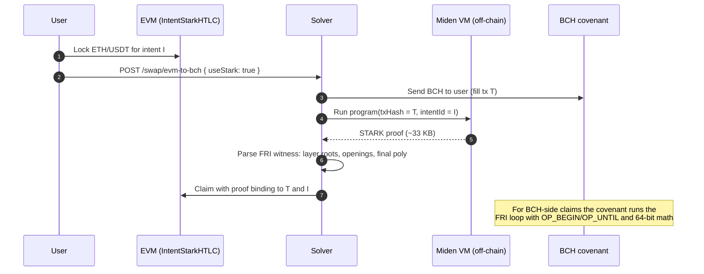

The solver proves *"I observed delivery transaction T for intent I"* by executing a small Miden VM program over those public inputs. The program's hash is committed inside every proof, so a proof for one intent can't be reused for another.



## Two layers of binding

1. **Semantic (inside the proof).** The program hash is fixed at compile time and committed in the proof. The program reads `txHash` and `intentId` as public inputs and emits a committed output. Change the intent id and you get a different proof.
2. **Covenant (on-chain).** The claim path checks the solver's key, the size and structure of the FRI commitments (6 × 32-byte layer roots), a Goldilocks-field fold check on the openings, the final polynomial size and the 32-byte delivery tx hash.

## Goldilocks arithmetic on BCH

The covenant performs field arithmetic modulo `p = 2^64 − 2^32 + 1` using the 64-bit `OP_MUL` / `OP_MOD` enabled in the May 2026 upgrade:

```text
p    = 18446744069414584321
INV2 = 9223372034707292161
check: (2 · x · INV2) mod p == x
```

## Planned for this page

- Proof generation timing and the prove queue
- Output binding and program-hash pinning (Phase B-gamma)
- Unlocking-bytecode size budget and how the witness fits
- Hardening required before mainnet
