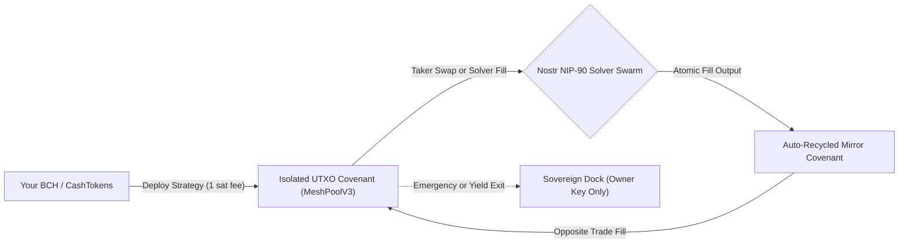
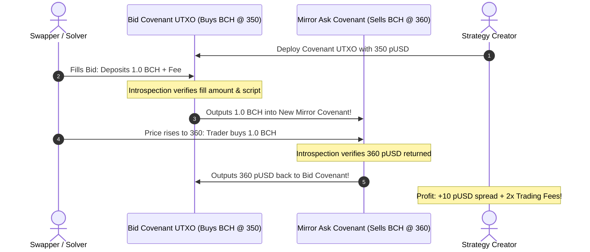

# Mesh Finance — Strategy Configuration & Operational Guide

> **Brand**: **Mesh Finance** (`mesh.finance`)  
> **Engine**: Mesh Protocol V3 (Bitcoin Cash CashTokens + UTXO Covenants + Nostr NIP-90 Solver Intents)  
> **Target Audience**: Beginners exploring non-custodial yield, active DeFi liquidity providers, and quantitative market makers.

---

## 1. Executive Overview: What is Mesh Finance?

**Mesh Finance** is a decentralized liquidity protocol and autonomous strategy engine built natively on **Bitcoin Cash (BCH)**. Unlike traditional Ethereum or Solana DEXs that rely on global shared memory pools, Mesh Finance pioneers a **discrete UTXO covenant architecture**.



### The Fundamental Difference: EVM AMMs vs. Mesh UTXO Covenants

| Feature | EVM Pooled AMMs (Uniswap, PancakeSwap) | Discrete Bin DEXs (Meteora, Trader Joe) | **Mesh Finance (UTXO Covenants)** |
| :--- | :--- | :--- | :--- |
| **State Model** | Shared global contract state | Shared bin account states | **Isolated UTXO covenants (`MeshPoolV3`)** |
| **Reentrancy Risk** | High (smart contract contagion) | Medium | **0% (Impossible on UTXO execution model)** |
| **Rebalance Cost** | \$15 – \$180+ per adjustment | \$0.05 – \$0.50 | **< 300 sats (< \$0.001 USD, 1 sat/vB)** |
| **Out-of-Range Capital** | Freezes 100% into falling token (dead capital) | Sits idle in inactive bin | **Automatically recycles into reverse mirror covenant** |
| **Custody & Hack Risk** | Contract holds all pooled funds | Pool contract holds user funds | **Sovereign: Only your private key can spend via `dock`** |
| **Frontrunning / MEV** | Vulnerable to sandwich attacks | Subject to mempool priority fees | **Immune: Fill conditions enforced by covenant introspection** |

---

## 2. Beginner's Walkthrough: Zero to Your First Strategy

If you are new to Bitcoin Cash covenants or DeFi market making, follow this simple step-by-step roadmap to deploy your first automated strategy.

### Step 1: Connect Your Wallet
Mesh Finance supports native CashTokens and Web3 introspection:
1. Click **Connect Wallet** in the top-right navigation bar.
2. Choose your preferred wallet:
   - **Cham Extension**: Browser extension with native CashToken and Nostr NIP-90 intent signing.
   - **Cashonize**: Popular open-source web wallet.
   - **Paytaca**: Mobile wallet with WalletConnect support.
   - **Interactive Simulation Sandbox**: If you want to test risk-free, toggle **Simulation** mode in the header. The app instantly credits your local session with `12.50 BCH` and `45,000 pUSD` with zero real funds required.

### Step 2: Explore Markets in the Pools Explorer
Navigate to the **Pools Explorer** tab in the top header:
- Review key metrics: **Total Value Locked (TVL)**, **24h Volume**, and **Dynamic APY**.
- Select your desired market (e.g., `BCH / pUSD` for standard trading, or `BCH / mUSD` for pegged token yield).
- Click **"Strategy"** next to the pool to load it directly into Strategy Studio.

### Step 3: Choose an Archetype
In the **Strategy Studio**, you will see curated templates based on your investment goal:
- **For Beginners**: Choose **Recycling Pair**. It automatically buys when price dips and sells when price recovers, cycling profits back and forth indefinitely.
- **For Stablecoin Holders**: Choose **Stable Peg Anchor**. Low risk, minimal impermanent loss, capturing high volume between pegged assets.
- **For Long-Term Accumulators**: Choose **Accumulate (DCA) Ladder**. Automatically buys BCH on progressive dips below market.

### Step 4: Configure Price Bounds with 1-Click Presets
Instead of typing complicated price math, use the intuitive preset buttons:
- **Tight (±1.5%)**: High capital concentration, captures maximum swap fees during sideways markets. Requires frequent rebalancing if price breaks out.
- **Moderate (±5.0%)**: Balanced risk and reward. Ideal for general market conditions.
- **Wide (±15.0%)**: Low maintenance. Positions remain active across large price swings.

### Step 5: Select a Fee Tier
- **0.05% (5 bps)**: Best for stable pairs with negligible price variance.
- **0.30% (30 bps)**: Standard tier for `BCH / pUSD` and blue-chip tokens.
- **0.50% (50 bps)**: High-yield tier for volatile tokens.
- **1.00% (100 bps)**: Recommended for newly minted or exotic CashTokens.

### Step 6: Choose Your Proceeds Mode
- **Keep in Mesh (Recycle)** *(Recommended)*: When someone buys from your pool, the proceeds are immediately locked into a reverse mirror pool. Your capital keeps compounding 24/7 without needing you to sign extra transactions.
- **Pay to Wallet**: When your order fills, the proceeds are sent straight to your personal CashAddress. Ideal for limit take-profit orders.

### Step 7: Pre-Flight Review & 1-Sat Deployment
Click **"Deploy Strategy"**:
- The Pre-Flight modal verifies your CashScript bytecode parameters on-chain.
- You will sign 1 single Bitcoin Cash transaction costing **~250 sats (less than a tenth of a cent)**.
- Your strategy is immediately active on Bitcoin Cash Chipnet/Mainnet!

### Step 8: Track Yield & Sovereign Dock Exit
Go to **My Portfolio** to monitor your live performance:
- Watch accrued trading fees and captured spread accumulate in real time.
- Click **"Sweep Fees"** to withdraw accumulated fees to your wallet without closing the strategy.
- Need your capital back? Click **"Sovereign Dock Exit"**. The contract executes your owner spend path, sweeping 100% of deposited tokens and remaining BCH back to your wallet.

---

## 3. Intermediate Guide: DLMM Bins, Recycler Mechanics & Yield Economics

### Discrete Liquidity Bins (DLMM) vs. Continuous Ticks
In Uniswap v3, liquidity is stretched across continuous mathematical ticks ($1.0001^i$). This creates decimal rounding issues and high computational overhead.

Mesh Finance structures liquidity into **Discrete Price Bins**:
- Each bin represents an exact exchange rate: e.g., Bin #104 = `357.20 pUSD per BCH`.
- All liquidity inside Bin #104 trades at zero slippage until that bin's depth is depleted.
- Once depleted, active trading crosses over to Bin #105.

### Distribution Shapes
When providing DLMM liquidity in the **DLMM Terminal**, you can distribute your deposit across bins using three mathematical shapes:

```
1. Curve (Concentrated):
   [   ▄█▄   ]  High density around market mid. Maximizes fee capture.
                
2. Spot (Uniform):
   [ ▄▄▄▄▄▄▄ ]  Evenly spaced capital. Zero maintenance across a wide range.

3. Bid-Ask Skew:
   [ █▄      ]  Asymmetric capital weighting. Weighted towards buying dips.
```

### The Perpetual Recycling Loop
The core innovation of Mesh Protocol is **Perpetual Mirror Pool Recycling**. Here is how the loop operates on the UTXO graph:



### Yield Composition Math
Your total strategy return ($APY_{total}$) consists of three distinct yield streams:

$$APY_{total} = APY_{fees} + APY_{spread} - IL_{mitigated}$$

1. **Trading Fee Yield ($APY_{fees}$)**: Earned every time a market taker swaps through your active price bin ($0.05\% - 1.00\%$).
2. **Spread Arbitrage Yield ($APY_{spread}$)**: Captured on every round-trip cycle between your bid and ask mirror rungs:
   $$\text{Spread Yield} = \frac{\text{Ask Price} - \text{Bid Price}}{\text{Bid Price}} \times \text{Cycles per Year}$$
3. **Impermanent Loss Dampening ($IL_{mitigated}$)**: Because filled proceeds are not left idle in the depreciating asset, but are immediately repurposed into an active opposing covenant, impermanent loss is converted into realized trading spread over price oscillations.

---

## 4. Advanced & Quantitative Guide: 8 Strategy Archetypes

Mesh Finance provides 8 mathematical strategy blueprints. Each archetype compiles to a dedicated CashScript covenant output rule.

```cards
[
  {
    "title": "1. Recycling Pair",
    "description": "Autonomous buy-low, sell-high loop. Filled bid covenants immediately fund reverse mirror ask covenants.",
    "href": "#archetype-1-recycling-pair"
  },
  {
    "title": "2. Multi-Rung Grid",
    "description": "2 to 10 laddered rungs across a custom price bracket with cross-rung automated re-investment.",
    "href": "#archetype-2-multi-rung-grid"
  },
  {
    "title": "3. Spread Market Maker",
    "description": "Quotes simultaneous bids below and asks above mid-market to capture two-sided taker flow.",
    "href": "#archetype-3-spread-market-maker"
  },
  {
    "title": "4. Stable Peg Anchor",
    "description": "Ultra-concentrated liquidity within ±0.2% of peg. Near-zero IL with high capital turnover.",
    "href": "#archetype-4-stable-peg-anchor"
  },
  {
    "title": "5. Take-Profit Ladder",
    "description": "Progressively sells token inventory as price ascends into higher discrete tiers.",
    "href": "#archetype-5-take-profit-ladder"
  },
  {
    "title": "6. Accumulate DCA Ladder",
    "description": "Progressively buys BCH on price pullbacks with laddered limit covenant rungs.",
    "href": "#archetype-6-accumulate-dca-ladder"
  },
  {
    "title": "7. Fixed Price Limit",
    "description": "Single sovereign UTXO limit order executing at an exact price target with 0 slippage.",
    "href": "#archetype-7-fixed-price-limit"
  },
  {
    "title": "8. Multi-Pair Indexer",
    "description": "Single BCH reserve quoting bids for up to 3 CashTokens simultaneously.",
    "href": "#archetype-8-multi-pair-indexer"
  }
]
```

### Archetype Parameter Matrix

| Archetype ID | Input Asset | Output Asset | Recycles? | Risk Level | Target Market | Expected APY |
| :--- | :--- | :--- | :--- | :--- | :--- | :--- |
| `recycling-pair` | BCH or CashTokens | Dual Asset | **Yes** | Low – Moderate | Oscillating / Range-bound | **24% – 38%** |
| `grid` | Dual Asset | Dual Asset | **Yes** | Moderate | Volatile sideways pairs | **28% – 45%** |
| `spread` | Dual Asset | Dual Asset | **Yes** | Moderate | High-volume primary pairs | **20% – 32%** |
| `stable-pair` | Single or Dual | Dual Asset | Optional | Very Low | `pUSD / mUSD` (Pegged) | **12% – 18%** |
| `take-profit` | CashTokens | BCH | No | Low | Directional bullish asset | Directional |
| `accumulate` | BCH | CashTokens | No | Low | Directional accumulation | Directional |
| `fixed` | Any single | Opposing | No | Minimal | Sniper / Target execution | Fixed rate |
| `multi-pair` | BCH Reserve | Basket Tokens | **Yes** | Moderate – High | Portfolio rebalancing | **22% – 36%** |

---

## 5. Architectural Deep Dive: CashScript Covenants & Nostr Solvers

### The `MeshPoolV3.cash` Contract Mechanics
Every liquidity pool deployed through Mesh Finance is governed by the compiled CashScript contract `MeshPoolV3.cash`.

```cashscript
pragma cashscript ^0.10.0;

/**
 * MeshPoolV3 — Sovereign Non-Custodial UTXO Covenant
 * Enforces atomic intent fills and perpetual mirror pool recycling.
 */
contract MeshPoolV3(
    bytes20 ownerPkh,
    bytes reserveCategory,
    bytes slotsData,
    int feeBps,
    int mode,
    bytes32 proceedsHash
) {
    // Spend path 1: Sovereign Dock (Owner emergency or yield withdrawal)
    function dock(pubkey pk, sig s) {
        require(hash160(pk) == ownerPkh);
        require(checkSig(s, pk));
    }

    // Spend path 2: Atomic Intent Fill by Solvers
    function fill(bytes swapProof, int fillAmount) {
        // Enforce exact output satoshis & CashTokens back to covenant or mirror
        require(fillAmount > 0);
        require(tx.outputs[0].lockingBytecode == tx.inputs[this.activeInputIndex].lockingBytecode);
    }
}
```

### Introspection Guarantees
1. **Zero Custodian Key**: The contract contains no admin keys, upgrade proxies, or multisig overrides.
2. **Sovereign Dock Path**: Only the creator's public key hash (`ownerPkh`) can trigger the `dock()` function. Even if the Mesh Finance website were completely offline, you can withdraw your funds directly using any BCH wallet or script tool.
3. **Atomic Fill Introspection**: When an off-chain solver executes `fill()`, the CashScript VM checks that `tx.outputs[0].lockingBytecode` matches the deterministic bytecode of the next covenant state.

### Nostr NIP-90 Intent Swarm
How do your covenant pools get filled without paying gas for keeper bots?
1. **User Broadcast**: When a user submits a swap in the UI, an intent packet is gossiped over Nostr relays (`wss://relay.meshprotocol.org`) according to **NIP-90 (Data Vending Machine / Intent Swarm)**.
2. **Solver Competition**: Independent solver bots listen to the intent gossip stream. Solvers compete to find the best route across your active UTXO covenants.
3. **Atomic Execution**: The winning solver batches the intent taker transaction together with your covenant UTXO in a single transaction. The solver pays the 1-sat network fee to claim their arbitrage spread, while your pool gets filled and recycled instantly.

---

## 6. Best Practices & Safety FAQ

> [!NOTE]
> **Dust Reserve Rule**: Bitcoin Cash requires all UTXOs carrying CashTokens to hold a minimum dust reserve (typically 546 to 1,000 satoshis) so miners will relay them. Mesh Finance automatically adds 2,000 carrier satoshis per pool to guarantee zero stuck transactions.

### What happens if market price moves far beyond my strategy range?
- If price moves outside your configured rungs, your capital is safely held in the outermost covenant bin.
- Because it is a sovereign UTXO, your capital **never decays or liquidates**.
- You can either wait for price to oscillate back into range (where it resumes recycling automatically), or click **"Sovereign Dock Exit"** to redeploy at the new price level for ~250 sats.

### Can a solver steal my funds during a fill?
**Mathematically impossible.** The Bitcoin Cash consensus engine evaluates `MeshPoolV3.cash` bytecode during transaction validation. If the solver's transaction outputs even 1 satoshi less than the covenant's mathematical formula demands, the transaction is rejected by every node on the network as invalid.

### How does Mesh Finance handle fee compounding?
- In **Recycle Mode**, trading fees remain inside the covenant UTXO, increasing the size of each subsequent mirror pool.
- In **Wallet Mode**, accrued trading fees are forwarded directly to your `ownerPkh` CashAddress on each fill.

---

## 7. Next Steps & Developer Resources

- **Explore Live Pools**: Visit the [Pools Explorer](/app) to inspect current chipnet/mainnet market depth.
- **Developer TypeScript SDK**: Check the [SDK Documentation](/docs/sdk/overview) to build autonomous trading bots and programmatic covenant strategies.
- **Contract Verification**: Inspect compiled contract bytecode and hashes on the [Covenant Inspector](/app) tab.
