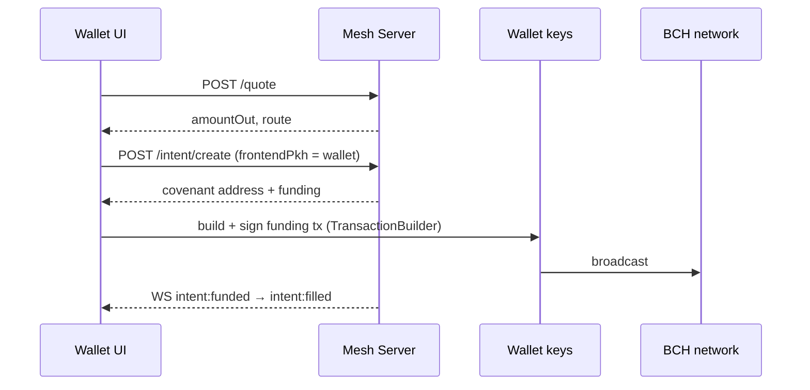

A wallet already holds the user's keys and UTXOs. That's everything an intent needs: the wallet funds the covenant, and solvers do the rest.

## Steps

1. **Quote** the pair and size.
2. **Create** the intent with the user's address as maker and your wallet's pkh as `frontendPkh`.
3. **Fund** from the user's UTXOs with `TransactionBuilder` against the covenant locking bytecode.
4. **Track** via the WebSocket or `GET /intent/:id` and show the fill or refund.

## To document

- Full TypeScript example from `examples/1-embedded-dex-wallet.ts`
- Handling token funding (token address + 1,000 sats)
- UX for `expired` → `refunded`
