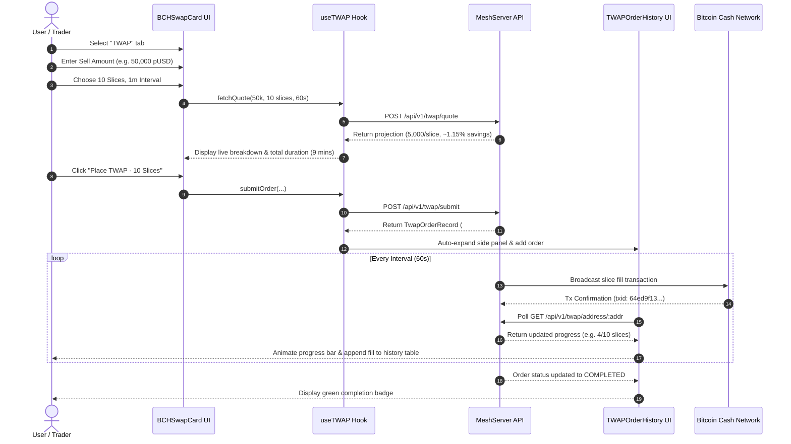
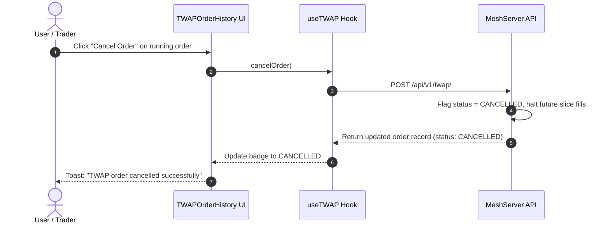

# 02 — TWAP User Journey & Interactive Flows

## 1. Primary Flow: Creating & Monitoring a TWAP Order

---

## 2. Secondary Flow: Order Cancellation

---

## 3. Error Handling & Edge Cases

| Scenario | System Behavior | UI Feedback |
| :--- | :--- | :--- |
| **No Wallet Connected** | Submit button directs user to connect wallet | Button renders `Connect Wallet` CTA |
| **Insufficient Balance** | Calculates available balance against entered amount | Red warning banner: `Insufficient pUSD balance` |
| **Network Failure during Quote** | Falls back to baseline mathematical estimation | Subtle indicator: `Estimated fallback quote` |
| **Partial Order Cancellation** | Immediately cancels all remaining slices | Executed slices remain safely recorded in fill history |
| **Drained Pools Mid-Execution** | Scheduler pauses and re-attempts next cycle | Status badge displays `PAUSED - Re-attempting in 15s` |
